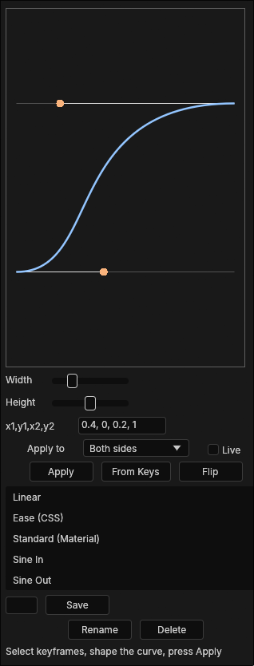

# PFlow

**A free easing-curve editor for [EffectCraft](https://github.com/storytold/effectcraft).** Draw a Bezier curve, save it as a preset, and apply it to your selected keyframes in one click.

> Independent, unofficial community script by Puuncture. Not affiliated with or endorsed by the EffectCraft authors or any other panel or company. Written from scratch against After Effects' documented scripting API, so it should also run in After Effects.

## Features
- **Visual curve editor.** Drag the two handles; hold **Shift** to snap to 0.05. Double-click the graph to reset to Linear.
- **Type or paste values.** Enter `x1, y1, x2, y2` or paste a CSS `cubic-bezier(0.4, 0, 0.2, 1)`.
- **Apply to keyframes.** Eases every pair of neighbouring selected keyframes, on any property (position, scale, opacity, shapes...), in one undo step. Speeds are scaled to each segment, so one curve fits any distance and duration.
- **Apply to both sides, only the out side (first key), or only the in side (second key).**
- **Live mode.** Re-applies the curve whenever you release a handle or pick a preset.
- **From Keys.** Reads the curve of the selected keyframes back into the editor.
- **Flip.** Reverses the curve.
- **27 built-in presets:** Sine, Quad, Cubic, Quart, Quint, Expo, Circ and Back (In / Out / In-Out), plus Linear, CSS Ease and Material Standard.
- **Your own presets.** Type a name and press **Save**; **Rename** and **Delete** manage them. They are stored in EffectCraft's script settings and survive restarts.
- **Resizable graph.** The **Width** and **Height** sliders set the size of the graph; the size is remembered.

## Requirements
EffectCraft with ScriptUI panel support (any recent version). No other dependencies.

## Install
**Option A: from the menu (easiest)**
1. Download `PFlow.jsx` from the [latest release](../../releases/latest) (or from the `ScriptUI Panels` folder).
2. In EffectCraft choose **File > Scripts > Install ScriptUI Panel...** and select `PFlow.jsx`.
3. Open it from the bottom of the **Window** menu: **Window > PFlow.jsx**. Dock it wherever you like; EffectCraft reopens it on the next launch.

**Option B: copy the file**
Put `PFlow.jsx` into the `Scripts/ScriptUI Panels/` folder inside EffectCraft's settings folder, then restart EffectCraft:

| OS | Settings folder |
|---|---|
| Windows | `%APPDATA%\EffectCraft` |
| macOS | `~/Library/Application Support/EffectCraft` |
| Linux | `~/.config/effectcraft` (or `$XDG_CONFIG_HOME/effectcraft`) |

## How to use
1. Select two or more neighbouring keyframes on a property in the timeline.
2. Pick a preset in the list, or shape the curve with the handles and press **Apply**.
3. Press **From Keys** any time to pull an existing ease into the editor, tweak it, and save it as a preset.

To save a preset: set the curve, type a name in the field under the list, press **Save**.

## Notes
- Select **neighbouring** keyframes (for example keys 1 and 2, or 2 and 3). Keys that aren't next to each other are skipped.
- Keyframes on locked layers are skipped.
- EffectCraft can't yet bind keyboard shortcuts to individual scripts, so PFlow opens from the Window menu.

## License
MIT, see [LICENSE](LICENSE). Copyright (c) 2026 Puuncture.
